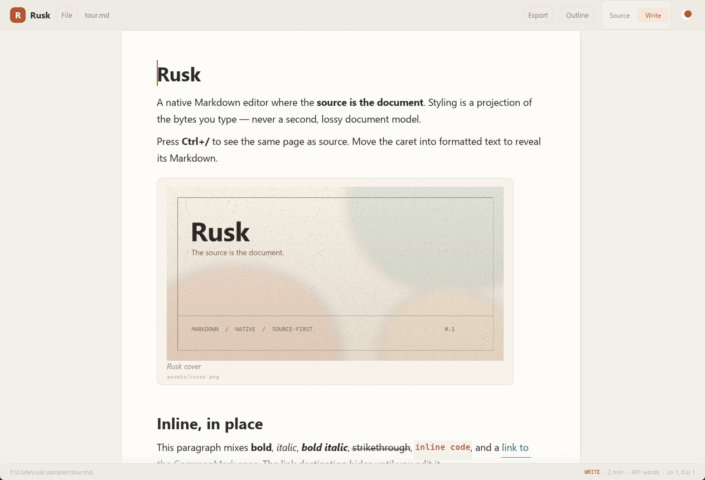
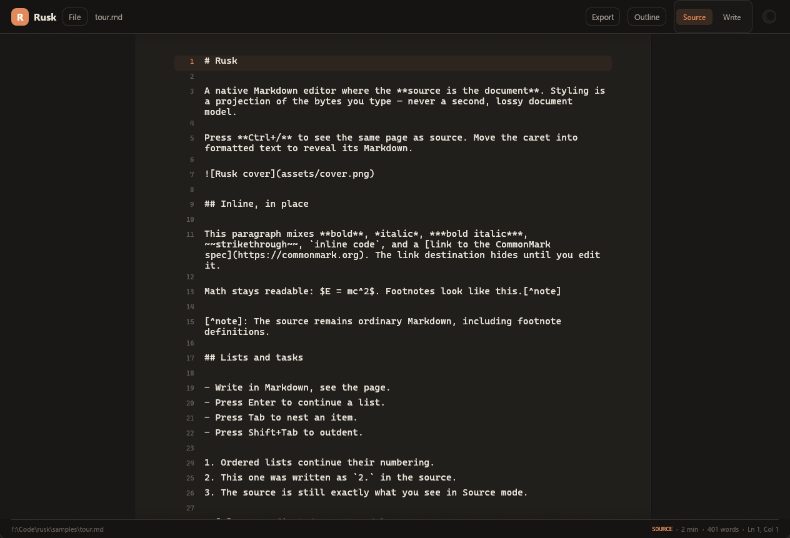
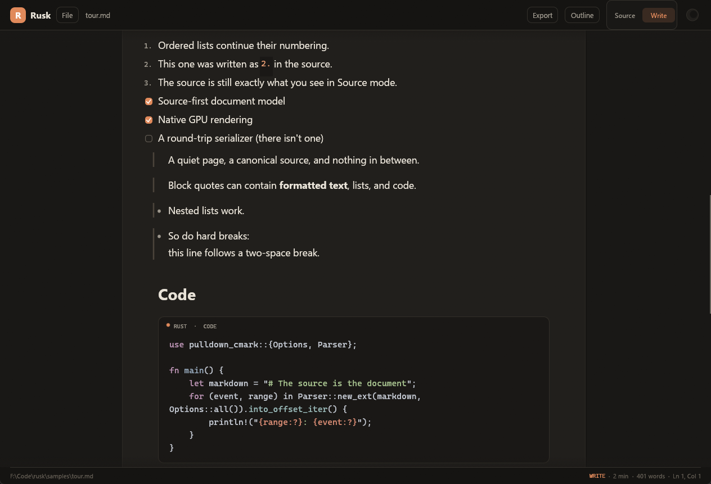

# Rusk

> 一个原生 Rust Markdown 编辑器。**Markdown 源码是唯一文档**，所见即所得只是源码的投影与装饰。

[](https://github.com/gantoho/rusk)
[](https://github.com/gantoho/rusk/actions/workflows/ci.yml)
[](LICENSE)

Rusk 不维护“富文本模型 → 导出 Markdown”的第二套文档，也没有 WebView。它用 `ropey` 保存原始字节，用 `pulldown-cmark` 为每个事件标注源码范围，再把语法标记“隐藏”成排版，把每一次输入写回同一份源码。



## 为什么是“源码投影装饰”

| 路线 | 问题 |
| --- | --- |
| 富文本模型 → 序列化 Markdown | 往返转换必然丢失信息，非标准语法回退复杂 |
| 源码 + 预览双栏 | 失去 Typora 式直接编辑体验 |
| **源码为唯一真相 + 投影装饰** | 无往返转换；源码模式零成本；需要精确的字节↔视觉映射 |

Rusk 采用第三条路线。它的核心不变式只有一条：

> 所有永久性编辑都通过事务写回同一份 Markdown 源码；视图层只读取源码，不产生第二份可编辑文档。

## 特性

- **Typora 式直接编辑**：标题、粗体、斜体、删除线、行内代码、链接、引用、列表、任务列表、代码块、表格、图片、分割线都在原位排版。
- **源码语法按需揭示**：光标进入格式化文本时，隐藏的 `**`、`` ` ``、`[链接](url)` 等标记会以弱化样式出现；离开后重新隐藏。
- **Markdown 源码模式**：`Ctrl+/` 一键切换，光标字节位置原样保留。源码模式带行号与当前行高亮。


- **原生渲染**：`eframe` + `wgpu`，无 Electron / Tauri / WebView，单个可执行文件。
- **CJK 与 IME**：自带中文字体回退、组合输入预览、候选窗口定位；中文与英文混排。
- **代码高亮**：按围栏代码块语言调用 `syntect`，预置浅色/深色主题；已闭合代码块在卡片内直接编辑正文，点击语言标签可修改语言。
- **表格**：始终渲染为网格；点击单元格后光标直接落在单元格文字内，可在网格中直接编辑。
- **图片**：本地相对路径/绝对路径图片直接渲染；加载失败时显示优雅占位符；点击图片进入源码编辑。
- **大纲面板**：按标题层级生成，点击跳转。
- **查找与替换**：`Ctrl+F` 打开查找条，`Ctrl+H` 展开替换；支持上一个/下一个、匹配计数、单次替换与全部替换。
- **流式编辑**：布局按块缓存；输入、移动光标和拖选时只重建受影响的块，其余块平移坐标复用，不再整篇重排。
- **导出 HTML**：复用同一主题 token 生成独立 HTML；也可以复制 HTML 到剪贴板。
- **撤销/重做**：事务式编辑，连续输入合并为一步。
- **文件工作流**：打开、保存、另存为、拖放打开、未保存关闭确认。
- **原生菜单**：Windows 下使用系统菜单栏（File / Edit / View），非 Windows 保留 egui 顶栏。
- **双主题**：Paper（暖白）与 Ink（暖黑）。

<table>
  <tr>
    <td></td>
  </tr>
</table>

## 快速开始

要求 **Rust 1.95+**（由 `eframe 0.37` 决定）。

```powershell
# 开发运行（欢迎页）
cargo run -p rusk-app

# 打开一个文件
cargo run -p rusk-app -- samples/tour.md

# 发布构建
cargo build --release -p rusk-app
.\target\release\rusk.exe samples\tour.md
```

也可以直接双击 `target\release\rusk.exe`，或把 `.md` 文件拖到窗口中。

> 体验编辑流畅度请使用 `--release`。debug 构建没有优化，字体排版与整篇解析会慢数倍，长文档尤其明显。

系统字体加载顺序针对 Windows 优化（Segoe UI / Microsoft YaHei / Cascadia Mono / Consolas），macOS 与 Linux 会回退到系统常见字体与 egui 内置字体。字体缺失不会阻止应用启动。

## 键盘快捷键

| 操作 | 快捷键 |
| --- | --- |
| Write / Source 切换 | `Ctrl + /` |
| 保存 / 另存为 | `Ctrl + S` / `Ctrl + Shift + S` |
| 打开 / 新建 | `Ctrl + O` / `Ctrl + N` |
| 查找 / 替换 | `Ctrl + F` / `Ctrl + H` |
| 下一个 / 上一个匹配 | `Enter` / `Shift + Enter`（或 `F3` / `Shift + F3`） |
| 导出 HTML | `Ctrl + Shift + E` |
| 切换大纲 | `Ctrl + Shift + O` |
| Paper / Ink 主题 | `Ctrl + Shift + D` |
| 粗体 / 斜体 / 行内代码 | `Ctrl + B` / `Ctrl + I` / ``Ctrl + ` `` |
| 插入链接 | `Ctrl + K` |
| 撤销 / 重做 | `Ctrl + Z` / `Ctrl + Y`（或 `Ctrl + Shift + Z`） |
| 按词移动 / 删除 | `Ctrl + ←/→` / `Ctrl + Backspace/Delete` |
| 打开链接 | `Ctrl + 单击` |
| 列表续行 / 退出空列表项 | `Enter` |
| 缩进 / 反缩进 | `Tab` / `Shift + Tab` |
| 快捷键帮助 | `F1` |

## 架构

```
┌─────────────────────────────────────────────────────────────┐
│                     eframe / wgpu Shell                     │
│   窗口 · 菜单 · 文件对话框 · 大纲 · Toast · 导出 · 主题      │
├─────────────────────────────────────────────────────────────┤
│                    rusk-app (editor)                        │
│   LayoutEngine ──> DocumentLayout ──> Painter               │
│        │                 │                                  │
│        │                 └── input hit-test / caret / IME    │
│        └── theme fonts · syntect · image cache               │
├─────────────────────────────────────────────────────────────┤
│                     rusk-core                               │
│  TextBuffer(ropey)  Parse(pulldown-cmark)  Projection        │
│  Transaction/History  Selection  Document/ViewMode           │
└─────────────────────────────────────────────────────────────┘
```

### crate 划分

- `crates/rusk-core`：与 UI 无关的文档内核。
  - `buffer.rs`：`ropey` 封装、字节/字符/行列转换、字素移动。
  - `transaction.rs`：非重叠编辑集合、应用与逆事务。
  - `document.rs`：文档、选择、撤销栈、模式、文件 IO、统计。
  - `markdown/`：块级 CST 与行内 span，全部保存源码字节范围。
  - `projection.rs`：把块投影成显示字符串 + 源码段映射；决定标记显示/隐藏。
- `crates/rusk-app`：原生编辑器外壳。
  - `editor/layout.rs`：排版、字体、代码块、表格、图片、源码行。
  - `editor/paint.rs`：绘制、选择、光标、IME 预编辑。
  - `editor/input.rs`：指针命中、键盘编辑、列表/缩进/格式化。
  - `editor/code.rs`：syntect 高亮。
  - `editor/images.rs`：本地图片纹理缓存。
  - `app.rs`：窗口、菜单、大纲、文件工作流、导出、模态框。
  - `theme.rs`：颜色 token、系统字体、egui 样式。

更细的设计与不变量见 [ARCHITECTURE.md](ARCHITECTURE.md)。

## 源码↔视觉映射

`Projection` 是显示字符串与源码之间的唯一桥梁：

```text
source:  A **bold** word
display: A bold word
segments:
  [A ]       -> 0..2   (普通)
  [bold]     -> 4..8   (粗体；2..4 的 `**` 被隐藏)
  [ word]    -> 10..15
```

- 每个显示段记录 `display_chars`、`display_bytes`、`source_bytes`。
- 普通段按字符线性映射；实体、软换行、裁剪过的行内代码等“原子段”吸附到边界。
- 光标与选区存的是**源码字节偏移**；视觉位置由投影实时计算。
- 隐藏的标记在光标进入其外层构造时加入投影，以 `syntax` 样式显示。
- 点击通过 `Galley::cursor_from_pos` 得到显示字符位置，再反查源码字节。

这样，源码模式不需要任何转换：把投影关掉、按行渲染原始字符串即可，光标字节位置天然一致。

## 编辑与事务

- 输入、删除、格式化、缩进都构造 `Transaction`，由 `apply()` 一次性写入 Rope。
- `apply()` 同时计算逆事务；`Document` 以快照 + 选择状态维护撤销栈。
- 连续输入（同类编辑、选择连续、700ms 内）合并为一步撤销。
- 隐藏的块级语法（`# `、`- `、`> `、围栏）默认不参与光标移动，避免误改 Markdown 结构；需要直接改结构时使用 Source 模式。

## 测试

```powershell
cargo test -p rusk-core
cargo test -p rusk-app
```

覆盖重点：

- UTF-8 安全编辑、字素移动、行列换算。
- 事务应用/逆事务、重叠编辑拒绝。
- CommonMark/GFM 块解析、嵌套列表、引用续行、围栏代码、表格。
- 投影隐藏/揭示、链接目标隐藏、标题标记策略、脚注样式。
- 列表续行前缀、Tab 缩进、标题标记保护、CJK 双击选词、CRLF 行尾。
- 查找全部匹配、替换全部的单步撤销与选择落点。

## 已知限制 / 下一步

1. **表格编辑**：网格始终保留，单元格文字内直接显示光标并编辑；暂未提供单元格内换行和逐 cell 富文本工具条。
2. **图片**：只加载本地图片；远程 URL 显示占位符。编辑图片语法会进入源码态。
3. **增量解析**：布局已按块缓存，但解析仍是整篇重做；超大文档（数 MB）需要可视区域虚拟化与增量解析。
4. **数学公式**：行内/块级公式只做强调样式，不进行 LaTeX 排版。
5. **PDF 导出**：HTML 导出已完成；PDF 可沿 HTML/CSS 管线继续做。
6. **查找选项**：当前为区分大小写的纯文本查找，暂未提供正则、整词或大小写切换。
7. **跨块格式化**：`Ctrl+B` / `Ctrl+I` / ``Ctrl+` `` 只处理单个块；跨段落/列表项的选区不会强行加标记，避免生成不合法 Markdown。
8. **主题持久化 / 最近文件**：尚未写入配置目录。

## 项目结构

```
rusk/
├─ Cargo.toml                 # workspace
├─ crates/
│  ├─ rusk-core/              # 无 UI 的文档内核 + 测试
│  └─ rusk-app/               # eframe 原生应用
├─ assets/icon.png            # 应用图标（构建时内嵌）
├─ samples/tour.md            # 功能巡览
├─ samples/assets/cover.png   # 示例图片
├─ docs/screenshots/          # README 截图
├─ tools/make_assets.py       # 生成图标与示例封面
├─ ARCHITECTURE.md
└─ README.md
```

## 参考与致谢

设计上参考了 Yu Markdown 的“源码是唯一真相 / 源码投影装饰”思想，以及 Velotype 等原生 Markdown 编辑器在块级交互上的经验。Rusk 的代码与实现是独立的。

核心依赖：`ropey`、`pulldown-cmark`、`eframe` / `egui` / `wgpu`、`syntect`、`rfd`、`image`。

## License

MIT.
