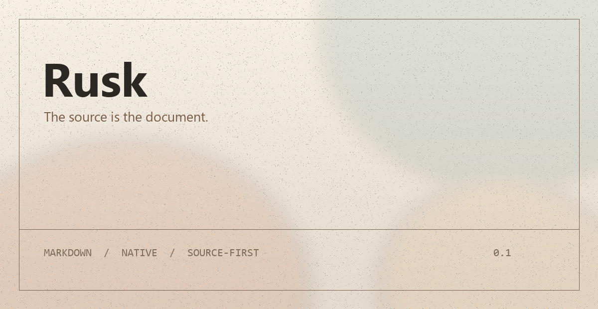

# Rusk

A native Markdown editor where the **source is the document**. Styling is a projection of the bytes you type — never a second, lossy document model.

Press **Ctrl+/** to see the same page as source. Move the caret into formatted text to reveal its Markdown.



## Inline, in place

This paragraph mixes **bold**, *italic*, ***bold italic***, ~~strikethrough~~, `inline code`, and a [link to the CommonMark spec](https://commonmark.org). The link destination hides until you edit it.

Math stays readable: $E = mc^2$. Footnotes look like this.[^note]

[^note]: The source remains ordinary Markdown, including footnote definitions.

## Lists and tasks

- Write in Markdown, see the page.
- Press Enter to continue a list.
- Press Tab to nest an item.
- Press Shift+Tab to outdent.

1. Ordered lists continue their numbering.
2. This one was written as `2.` in the source.
3. The source is still exactly what you see in Source mode.

- [x] Source-first document model
- [x] Native GPU rendering
- [ ] A round-trip serializer (there isn't one)

> A quiet page, a canonical source, and nothing in between.
>
> Block quotes can contain **formatted text**, lists, and code.
>
> - Nested lists work.
> - So do hard breaks:  
>   this line follows a two-space break.

## Code

```rust
use pulldown_cmark::{Options, Parser};

fn main() {
    let markdown = "# The source is the document";
    for (event, range) in Parser::new_ext(markdown, Options::all()).into_offset_iter() {
        println!("{range:?}: {event:?}");
    }
}
```

```python
def project(source: str, caret: int) -> str:
    """Hide syntax, keep the bytes."""
    return source if caret else source
```

## Tables

| Concern | Choice | Why |
| :--- | :---: | --- |
| Text buffer | `ropey` | O(log n) edits |
| Markdown | `pulldown-cmark` | byte ranges for every event |
| Render | `eframe` / wgpu | native, no WebView |
| Source of truth | Markdown | no round-trip loss |

---

## Typography

### Heading three

#### Heading four

##### Heading five

###### Heading six

中文与 English 混排时，行高、字重和标点都应当自然。**粗体中文**、*斜体中文*、`code 代码` 和 [中文链接](https://example.com) 都来自同一个源码投影。

The end. Everything above is Markdown, byte for byte.
